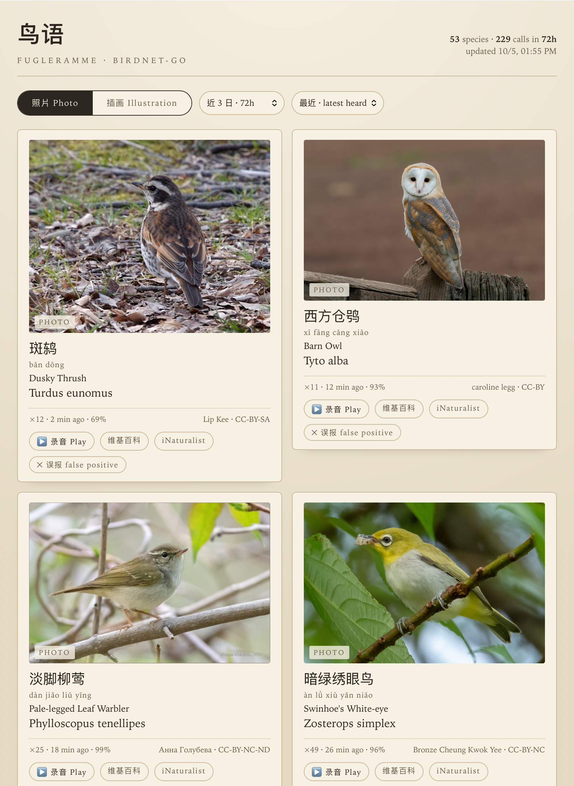

# fugleramme-web

A bird frame for a self-hosted [BirdNET-Go](https://github.com/tphakala/birdnet-go):
every species heard in the last few hours is drawn on one page, named in **Chinese and
English**, and can be shown as **1800s hand-cut plates**, as **real photos**, or as
**stickers** — plus a **分类 taxonomy page** that browses a whole 11,064-species sticker
library by order and family.

Point it at a station, open the page, put it on a screen.



## Run it

```bash
npm install                                               # pinyin-pro, the only dependency
BIRDNA_URL=http://192.168.10.207:8080 node server.mjs   # → http://0.0.0.0:8090
npm test                                                # the pure helpers
```

Node 20+. No build step.

| variable | default | what it does |
| --- | --- | --- |
| `BIRDNA_URL` | `http://192.168.10.207:8080` | the BirdNET-Go station (no auth needed) |
| `PORT` | `8090` | where the frame is served |
| `DATA_DIR` | `./data` | cache: plates, photos, names |
| `FETCH_TIMEOUT_MS` | `20000` | upstream timeout |

## Where the pictures and names come from

| | source | licence |
| --- | --- | --- |
| plates | [fugleramme](https://github.com/arnegiacomo/fugleramme) artwork (`assets/artwork/classic`) | CC BY-SA 4.0 |
| stickers | [huashu-bird-sticker](https://github.com/alchaincyf/huashu-bird-sticker) — 11,064 species at `stickers/<Order>/<Family>/<Genus_species>.webp` | PolyForm Shield 1.0.0 (free for anything but a competing birding/ID app) |
| photos + 中文名 | [iNaturalist](https://www.inaturalist.org) taxon API (`locale=zh-CN`), CC-licensed photo preferred | per photo, credited on the card |
| 中文目/科名 + IOC names | the sticker library's own `data/species.json`, names from the [IOC World Bird List](https://www.worldbirdnames.org) v15.2 | MIT (data) · CC BY 3.0 (names) |
| 详情链接 | [中文维基百科](https://zh.wikipedia.org) article by scientific name, falling back to the English article iNaturalist links | — |

Each species is fetched **once** and cached under `DATA_DIR`. After the first sighting the
frame works with the internet unplugged — which is the point on a NAS. Chinese names come
from iNaturalist's locale data in **Simplified** script (`zh-CN`; its plain `zh` locale is
Traditional). BirdNET-Go itself ships no Chinese dictionary: its `speciesdict` covers 15
European languages only.

Every card links out to read more: 维基百科 when a Chinese article exists, else the English
Wikipedia article, plus the iNaturalist taxon page (which is localised to Chinese too).
Over the Chinese name sits its tone-marked pinyin, romanized locally with `pinyin-pro`
(the only dependency) and cached with the rest of the species.

A species fugleramme has no plate for falls back to its photo, and the card's tag says so.
Artwork is filed under the *current* genus, so a station upgraded across a reclassification
is matched through fugleramme's own `birdnet_aliases.json` — and through the same alias map
into the sticker library, which is also filed under the current genus.

The sticker library's `data/species.json` (33 MB) is **not** read at runtime. Its useful
fields are trimmed once into `assets/stickers.json` — `{orders → families → species}` in IOC
sequence, 1.4 MB raw / 314 kB gzipped — which ships in the repo and in the image, so the
frame and the 分类 page work with the internet unplugged from the first request. Each
species keeps only what a tile shows: the two names, the library's own tone-marked pinyin,
its Chinese Wikipedia title (4,010 of 11,064) and its iNaturalist taxon id (661). The 目 and
科 headings get pinyin too — the library has none for a taxon's own name, so the trimmer
romanizes those 294 strings with `pinyin-pro`. To refresh it from upstream:

```bash
node --input-type=module -e '
  const { taxonomyIndex } = await import("./server.mjs");
  const url = "https://raw.githubusercontent.com/alchaincyf/huashu-bird-sticker/main/data/species.json";
  const { species } = await (await fetch(url)).json();
  await (await import("node:fs/promises")).writeFile("assets/stickers.json", JSON.stringify(taxonomyIndex(species)));
'
```

Each sticker image is cached under `DATA/sticker/<Order>/<Family>/` as it is first shown, so
browsing the page once makes that part of the library offline-ready too; `rm -rf
DATA/sticker` is the reset (the whole library is ~550 MB).

## On the NAS (TrueNAS)

Point `BIRDNA_URL` at whatever the station answers to from inside the container - the
service name if both run in one compose stack, otherwise the host:

```yaml
services:
  fugleramme-web:
    image: ghcr.io/dakai/fugleramme-web:latest
    ports: ["8090:8090"]
    environment:
      BIRDNA_URL: http://host.docker.internal:8080   # Linux: needs extra_hosts below
    extra_hosts: ["host.docker.internal:host-gateway"]
    volumes: ["./data:/data"]
    restart: unless-stopped
```

`docker compose up -d` pulls the image; there is nothing to build on the NAS. The cache
lives in `./data` (`DATA_DIR=/data` in the image), so plates, photos and names survive
image updates. Pushing to `main` rebuilds and republishes via `.github/workflows/image.yml`
(linux/amd64 + linux/arm64).

### Updating the app

Every push to `main` publishes **two** tags: `:latest` and `:<full-commit-sha>`
(e.g. `ghcr.io/dakai/fugleramme-web:7066ce7…`). Pin the SHA one in your YAML and a
normal redeploy always lands the new image, because a changed image reference is a
changed compose file. `:latest` is a pointer, not a version — with it, a redeploy of
unchanged YAML just recreates the container from whatever is already on disk, because
the tag string did not change.

If you keep `:latest`, pull it explicitly before redeploying:

```bash
midclt call app.pull_images fugleramme-web   # TrueNAS: re-pull a custom app's floating tag
```

There is no reliable re-pull for a custom YAML app in the web UI; `app.redeploy` alone
does not contact the registry.

## How it behaves

- `GET /api/frame?hours=24` — detections in the window, grouped per species, each enriched
  with plate, sticker, photo and 中文名. `hours` is clamped to 1…168.
- `GET /api/taxonomy` — the sticker library's whole taxonomy, orders → families → species in
  IOC sequence (44 / 250 / 11,064), gzipped for the wire. Served from the vendored
  `assets/stickers.json`: no network, no first-use download. 503 only if that asset is
  missing from the deployment.
- `GET /img/sticker/<Order>/<Family>/<Genus_species>.webp` — one sticker, read-through cached
  under `DATA/sticker/`. The three path segments are validated by the route's regex, so no
  traversal is possible.
- **Nothing polls.** The frame is read on load, when the time window changes, and when
  `⟳ 刷新 Refresh` is pressed — a kiosk left alone keeps the frame it has. The button sends
  `?refresh=1`, which rebuilds even inside the server's 20 s frame cache; a plain load may
  reuse a frame built up to 20 s ago (`?hours=` is part of the cache key).
- 照片 Photo is the default view (whole image, not cropped), and it is where the call is
  played, the false positive dropped and the names read. 插画 Illustration is the
  **fugleramme collage**: up to **12 plates on one frame**, nothing else — no buttons, no
  links, no pinyin, and **no photo fallback**: a species fugleramme never drew is left out
  of the sheet rather than shown as a photo. More species than that and the collage rolls
  into another frame (`◀ 第 1 / 2 帧 ▶`).
- 贴纸 Sticker is the same sheet with a different library: up to 12 stickers on pure white
  paper, the same handwritten names, paging and `⤓ A4 PDF`. A sticker is already cut to its
  bird with a white outline, so the sheet is `#fff` and the paper-normalising canvas pass is
  skipped (`onPaper` is plate-only). Stickers are drawn at the bird's own mass term — there
  is no plate slack to compensate for — and a species the library does not cover is left out
  of the sheet, never shown as a photo.
- 分类 Categories (`/categories.html`) browses the whole sticker library instead of the
  last few hours: 44 orders → 250 families → 11,064 species, each 目 and 科 heading and
  each species tile carrying its tone-marked pinyin over the Chinese name, plus the English
  and scientific names, a 维基百科 link (the Chinese article when the library knows one, else
  a zh-wikipedia search) and an iNaturalist taxon link where the library has the taxon id.
  IOC sequence is preserved.
  One fetch, then everything is client-side; the level lives in the URL hash
  (`#Passeriformes/Turdidae`), so a reload lands on the same family.
- In the photo grid a sorter sits beside the time window: 最近 latest heard (default),
  最多 most calls, 最少 rarest, 首次 first heard — ties fall back to the freshest. It orders
  the grid only; both sheets keep their own size order, so the sorter hides with them.
- **The collage is drawn the way fugleramme draws it.** Birds are sized by **real body
  mass** — AVONET grams (`assets/bird-masses.json`, Tobias et al. 2022, CC BY 4.0) raised to
  `0.14` so the heaviest reads ~2.5× the lightest — and the plate that carries a bird is
  drawn tall enough for it to land at that size, however loose its crop (`geometry.json`).
  So a heron leads the sheet and a warbler ends it, and two very different plates of one
  species draw the same bird. Each plate stands on a shared baseline, captioned underneath
  in handwriting.
  Each plate's paper is normalised onto the sheet's tone in a canvas (`onPaper`, a port of
  fugleramme's `paper.process_sprite`): the plate's own paper tone is measured from its cut
  edge, the paper reachable from outside is flooded and painted flat, and only the paper the
  ink walls off is pulled toward the tone — so white plumage, pale water and the painted
  ground under a bird survive untouched. `PAPER` is fugleramme's own `TARGET_PAPER`, aged
  cream rather than white, because the plates' paper is not white.
- **What you see is the sheet that prints.** The illustration frame is laid out as an A4
  landscape page: every bird and caption is sized in percent of the *sheet's* height, so the
  screen composition and the PDF are the same page. The birds are then drawn as large as the
  sheet allows, so a frame of twelve fills the page instead of sitting in the middle of it.
  Plates are drawn whole, never cropped, and no blend mode is used — the paper is already the
  page's tone, so the screen and the paper show the same thing. The sticker sheet is the
  same box with `#fff` for `--sheet`.
- **⤓ A4 PDF prints one frame per sheet.** The print stylesheet is A4 landscape with zero
  margin and hides everything but the current frame, so the browser's own *Save as PDF*
  writes a single A4 file for the frame on screen — no PDF library, nothing to install.
  The handwriting is [Ma Shan Zheng](https://fonts.google.com/specimen/Ma+Shan+Zheng)
  (OFL, vendored at `public/fonts/`), the only CJK handwriting face guaranteed to exist
  offline; it carries Latin glyphs too, so one 3 MB file covers both names.
- **Each card plays the call.** `▶ 录音 Play` streams the newest detection's clip through
  the frame (`GET /api/audio/:id`), so nothing third-party is fetched by the browser.
  While it plays the button fills from the left like a progress bar, so a running call is
  visible and not just audible; a paused one keeps its fill, an ended one empties it.
- **`✕ 误报 false positive` deletes that detection from BirdNET-Go** (`DELETE
  /api/detection/:id`) after a confirmation — the record is gone from the station, not just
  hidden here. Needs the station running without HTTP auth; a protected station answers 401
  and the card says so in the banner.
- **A detector blip never blanks the glass.** Upstream failures serve the last good frame
  with `"stale": true` (the page says so); with no frame ever built the endpoint is 503.
- The chosen style and time window live in `localStorage`, so a kiosk keeps them.

## Verified

`npm test` covers plate-file matching, species grouping, the time window, which
detection a card's recorder addresses, and the sticker library trimmed to orders →
families → species (including a recent split with no Chinese name). Against the live
station at `192.168.10.207:8080`: plates, photos, both names, the photo and illustration
modes, whole-image photos, clip playback, the empty state, and the stale hold when the
detector is unreachable. The false-positive delete was exercised end to end against a
stand-in station, never against real data.
The progress fill was checked in Chromium against a stand-in station: it tracks the clip,
survives a re-render, holds on pause and empties on `ended`.
The collage was checked in Chromium against the live station: birds sized by mass (a
bittern drawn taller than a wagtail), plates flattened into the sheet, species with no
plate left out, 12 to a frame, and each frame one A4 landscape page
(`pdfinfo`: 1 page, 841.92 × 595.92 pt).
The sticker sheet was checked the same way: a white A4 page, 12 stickers with both
captions, one frame per page (`pdfinfo`: 1 page, 841.92 × 595.92 pt, white corner), and
switching sticker → illustration → photo → sticker in one session.
`/api/taxonomy` answers 44 orders / 250 families / 11,064 species from the vendored asset —
1,394,278 bytes, 312,725 gzipped on the wire, 204 ms on the first call and memoised after
that, with the library's 33 MB `species.json` made unreachable to prove no download happens.
The 分类 page was walked in Chromium: 44 order cards, 雀形目 → 143 family rows including
鸫科 · Thrushes · 190 种, 鸫科 → 190 sticker tiles. Pinyin sits over all 44 目 names, all
250 科 names and 188 of the 190 species (two recent splits have no Chinese name); 维基百科
is on every tile and iNaturalist where the library carries a taxon id.
`#Passeriformes/Turdidae` survives a reload, and the breadcrumb walks back.
With `assets/stickers.json` removed, `/api/taxonomy` answers 503 and the 分类 page shows
its note naming the missing file, while `/api/frame` still serves every detection with
`stickerUrl: null`.
